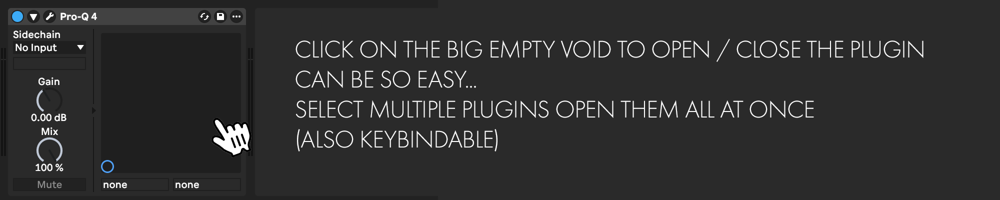

# [MAC/WIN] HYNE Ableton Shortcuts Manager (HYNE ASM)

Insert plugins, presets and Live commands in seconds: a double right-click in Ableton Live opens your own menu,
⌃Space (Mac) or Ctrl+Space (Windows) opens the quick search. Free and open source.

## New in 1.2.2

- Big plugin libraries load reliably and much faster. Update the Live script once: menu → **Install Live Script …**,
  then restart Live.
- Folder side lists open away from neighbouring folders. Mac: folders in Settings open on hover or click.
- Windows: dropping plugins onto a folder puts them inside it.

*Neu in 1.2.2: Große Plugin-Sammlungen laden zuverlässig und schneller (Live-Script einmal neu installieren),
Ordner-Listen verdecken keine Nachbarordner mehr, Mac: Ordner in den Einstellungen öffnen sich per Hover oder Klick,
Windows: Plugins landen beim Ziehen im Ordner.*

## Right Click Panel


## Click to open plugins



## CTRL + SPACE panel


## Settings


## Bridge Setup


## Feedback
Please leave feedback as a reddit comment here. I wanna shape the App further and implement new features / fix bugs <3
https://www.reddit.com/r/ableton/comments/1y0o0ar/i_built_an_opensource_ableton_shortcut_manager/

## Download

| | Download | Requirements / Voraussetzungen |
|---|---|---|
| **Mac** | **[⬇ HYNE-ASM-….dmg](https://github.com/hynemusic/hyne-asm/releases/latest)** | macOS 13 or later, Ableton Live 12 |
| **Windows** | **[⬇ HYNE-ASM-Windows-Setup-….exe](https://github.com/hynemusic/hyne-asm/releases/tag/win-v1.2.2)** | Windows 10 or 11 (64-bit), Ableton Live 12 |


(Virus Total for Windows: https://www.virustotal.com/gui/file/1770eb95ee8a4a55fdb1a2c6dadfe4a37de73aacd192af290051a2c6a7cbf2a9/detection)
Menus move between Mac and Windows (Settings → Profiles → Export / Import).

<details>
<summary><b>Changelog</b></summary>

**1.2.1**
- A wrench next to the Plugins & Presets count (Settings → Library) lists the folders Live reads plugins and presets
  from, with how to add your own folder in Live.

**1.2**
- Click anywhere in a plugin's X-Y field to open or close its window (hold ⌥ / Alt to use the field as usual).
  Shift-selected plugins open together. Switch under **Settings → Behavior → Plugin Windows**.
- A shortcut opens or closes all plugin windows of the track (**Settings → Shortcuts → Plugin Windows**).

**1.1** (Windows)
- One small setup (about 1 MB) instead of the 66 MB zip; it fetches Microsoft's .NET Desktop Runtime if needed.

**1.0**
- First release.

</details>

---

## Install (English)

### Mac

1. Download **HYNE-ASM-….dmg** from [Releases](https://github.com/hynemusic/hyne-asm/releases/latest) and open it.
2. Drag **HYNE Ableton Shortcuts Manager** into **Applications**.
3. The first time, macOS blocks the app because it isn't checked through Apple's paid program. Allow it once:
   - **macOS 15 and later:** open the app, close the message, then **System Settings → Privacy & Security**, at the
     bottom next to HYNE ASM click **"Open Anyway"** and confirm.
   - **macOS 13–14:** **right-click the app → Open → Open**.
4. The welcome window walks you through the rest: allow Accessibility, install the Live script ASMbridge, restart
   Live and choose ASMbridge as the Control Surface, set up your first menu.

You can reopen the introduction any time from the menu bar icon → **Show Introduction …**.
To update, download the new DMG and replace the app; your settings stay.

### Windows

1. Download **HYNE-ASM-Windows-Setup-….exe** from the
   [Windows release](https://github.com/hynemusic/hyne-asm/releases/tag/win-v1.2.2) (about 1 MB).
2. Start it. The first time, Windows may show "Windows protected your PC" because the app isn't signed with a paid
   certificate: click **More info → Run anyway**.
3. Click **Install**. If your PC doesn't have Microsoft's free **.NET Desktop Runtime** yet, the setup downloads it from
   Microsoft and installs it (Windows asks once for admin rights). HYNE ASM starts at the end.
4. The welcome window walks you through the rest:
   - Click **Install Live Script** (it goes into your User Library).
   - Restart Live, then choose **Settings → Link, Tempo & MIDI → Control Surface: ASMbridge** (Input/Output: None).
   - Try it: double right-click a track in Live, or press **Ctrl+Space**.
5. HYNE ASM lives in the notification area at the bottom right of the taskbar (maybe behind the **^** arrow; drag the
   icon onto the taskbar to keep it visible). Right-click it for the menu, double-click it for the settings. Turn on
   **Start with Windows** to have it start by itself. It's in the Start menu as **HYNE ASM**.

To update, download the new setup and run it; it closes the running app itself and your settings stay.

## Installieren (Deutsch)

### Mac

1. Lade die Datei **HYNE-ASM-….dmg** unter [Releases](https://github.com/hynemusic/hyne-asm/releases/latest) herunter
   und öffne sie.
2. Zieh **HYNE Ableton Shortcuts Manager** in den Ordner **Programme**.
3. Beim ersten Öffnen blockiert macOS die App, weil sie nicht über Apples kostenpflichtiges Programm geprüft ist.
   Einmal freigeben:
   - **macOS 15 und neuer:** App öffnen, Meldung schließen, dann **Systemeinstellungen → Datenschutz & Sicherheit**,
     ganz unten bei HYNE ASM auf **„Trotzdem öffnen“** klicken und bestätigen.
   - **macOS 13–14:** **Rechtsklick auf die App → Öffnen → Öffnen**.
4. Das Willkommensfenster führt durch den Rest: Bedienungshilfen erlauben, das Live-Script ASMbridge installieren,
   Live neu starten und ASMbridge als Control Surface wählen, dein erstes Menü anlegen.

Die Einführung lässt sich jederzeit über das Menüleisten-Symbol → **Einführung zeigen …** wieder öffnen.
Für ein Update lädst du einfach die neue DMG und ersetzt die App; deine Einstellungen bleiben erhalten.

### Windows

1. Lade **HYNE-ASM-Windows-Setup-….exe** unter
   [Windows-Release](https://github.com/hynemusic/hyne-asm/releases/tag/win-v1.2.2) herunter (etwa 1 MB).
2. Starte sie. Beim ersten Mal zeigt Windows eventuell „Der Computer wurde durch Windows geschützt“, weil die App
   nicht mit einem kostenpflichtigen Zertifikat signiert ist: auf **Weitere Informationen → Trotzdem ausführen** klicken.
3. Auf **Installieren** klicken. Fehlt auf deinem PC Microsofts kostenlose **.NET Desktop Runtime**, lädt das Setup sie
   selbst von Microsoft und installiert sie (Windows fragt dafür einmal nach Admin-Rechten). Am Ende startet HYNE ASM.
4. Das Willkommensfenster führt durch den Rest:
   - **Live-Script installieren** klicken (es kommt in deine User Library).
   - Live neu starten, dann **Einstellungen → Link, Tempo & MIDI → Control Surface: ASMbridge** wählen
     (Input/Output: None).
   - Ausprobieren: doppelter Rechtsklick auf eine Spur in Live, oder **Strg+Leertaste**.
5. HYNE ASM läuft im Infobereich rechts unten in der Taskleiste (eventuell hinter dem **^**-Pfeil; zum Anheften das
   Symbol auf die Taskleiste ziehen). Rechtsklick darauf öffnet das Menü, Doppelklick die Einstellungen. Unter
   **Mit Windows starten** startet es automatisch. Im Startmenü findest du es als **HYNE ASM**.

Für ein Update lädst du einfach das neue Setup und startest es; es schließt die laufende App selbst, deine
Einstellungen bleiben erhalten.

---

## Is this safe? / Ist das sicher?

**English**
- All the code is public here. Every download is built by GitHub itself from exactly this code, not on a private
  computer. Under [Actions](https://github.com/hynemusic/hyne-asm/actions) you can see the build each release came
  from; every download comes with its SHA-256 checksum.
- **Mac – Accessibility:** needed for the double right-click and the shortcuts in Live. **Windows** needs no special
  permission; the setup installs into your user folder without admin rights (only Microsoft's .NET runtime needs them,
  once). On both, the app only reacts while Live is in front.
- **Live script (ASMbridge):** a small Python script in *User Library/Remote Scripts* that the app uses to insert
  plugins in Live.
- **Network:** no internet connection. The app only talks to Live on your computer (127.0.0.1). The optional Stream
  Deck link is off by default and also reachable from your computer only.
- Your settings stay with you: `~/Library/Application Support/HYNE ASM` (Mac) or `%APPDATA%\HYNE ASM` (Windows).

**Deutsch**
- Der gesamte Code ist hier öffentlich. Jede Download-Version wird von GitHub selbst aus genau diesem Code gebaut, nicht
  auf einem privaten Rechner. Unter [Actions](https://github.com/hynemusic/hyne-asm/actions) siehst du zu jeder Version
  den Build, aus dem sie stammt; neben jedem Download liegt seine SHA-256-Prüfsumme.
- **Mac – Bedienungshilfen:** nötig, damit der doppelte Rechtsklick und die Tastenkürzel in Live funktionieren.
  **Windows** braucht keine besondere Freigabe; das Setup installiert ohne Admin-Rechte in deinen Benutzerordner (nur
  Microsofts .NET-Laufzeit braucht sie einmal). Auf beiden Systemen reagiert die App nur, während Live vorne ist.
- **Live-Script (ASMbridge):** ein kleines Python-Script im Ordner *User Library/Remote Scripts*, über das die App
  Plugins in Live einfügt.
- **Netzwerk:** keine Verbindung ins Internet. Die App spricht nur mit Live auf deinem Rechner (127.0.0.1). Die
  optionale Stream-Deck-Verbindung ist standardmäßig aus und ebenfalls nur auf deinem Rechner erreichbar.
- Deine Einstellungen liegen nur bei dir: `~/Library/Application Support/HYNE ASM` (Mac) bzw. `%APPDATA%\HYNE ASM`
  (Windows).

## Uninstall / Deinstallieren

**Mac**
1. Quit HYNE ASM (menu bar icon → Quit) and move the app from Applications to the Trash.
2. Delete `~/Library/Application Support/HYNE ASM` (your menu and settings).
3. Delete the folder `ASMbridge` in `~/Music/Ableton/User Library/Remote Scripts` and, in Live's preferences, set the
   Control Surface back to None.
4. Optional: remove HYNE ASM under System Settings → Privacy & Security → Accessibility.

**Windows**
1. Windows Settings → **Apps** → **HYNE ASM** → **Uninstall** (also removes the `hyneasm://` link and Start with Windows).
2. Delete `%APPDATA%\HYNE ASM` (your menu and settings).
3. Delete the folder `ASMbridge` in `Documents\Ableton\User Library\Remote Scripts` and, in Live's settings, set the
   Control Surface back to None.

---

## For developers

- **Mac:** Swift package (macOS 13+, Swift 6) in `Sources/` and `Tests/`.
- **Windows:** .NET 8 in `windows/`: `HyneAsm.Core` (the logic, plain `net8.0`) and `HyneAsm.App` (WPF).
- **Shared:** the Python Live script in `bridge/ASMbridge`, and `spec/fixtures`: test cases both `swift test` and
  `dotnet test` run, so the two apps behave the same. The Swift app is the reference (`spec/record-fixtures.sh`
  records its answers). See [docs/parity.md](docs/parity.md) for every feature on both platforms.

### Tests

```bash
swift test
dotnet test windows/HyneAsm.sln
python3 -m unittest discover -s bridge/tests
HM_LIVE_TEST=1 swift test --filter LiveIntegrationTests   # needs Live running with ASMbridge selected
```

### Build & install from source (Mac)

The app needs a stable code signature, otherwise macOS drops the Accessibility permission after every build. Any
code-signing identity in your keychain works, for example a free "Apple Development" certificate from Xcode
(Settings → Accounts → Manage Certificates) or a self-signed one. `security find-identity -p codesigning` lists them.

```bash
HM_SIGN_IDENTITY="<your identity name>" scripts/build-app.sh --install
```

Then in the HYNE ASM menu bar menu → "Install Live Script …", restart Live, and select "ASMbridge" as the control
surface (Input/Output: None).

### Build from source (Windows)

Needs the .NET 8 SDK. The app compiles on macOS and Linux too, but only runs on Windows. It uses the .NET Desktop
Runtime installed on the PC, so the exe stays under 1 MB; `windows/installer/HyneAsm.iss` (Inno Setup) wraps it in the
setup, which adds the runtime when it's missing.

```bash
dotnet publish windows/HyneAsm.App/HyneAsm.App.csproj -c Release -r win-x64 --self-contained false -p:PublishSingleFile=true -o publish
```

Every pull request also builds the setup as a downloadable test build (Actions → the run → Artifacts).

### Releases

- **Mac:** pushing a tag `vX.Y.Z` runs `.github/workflows/release.yml`: it tests, builds with `HM_VERSION=X.Y.Z`, signs
  with the project's "HYNE ASM" certificate (stored as repository secrets), checks tag, version, certificate
  fingerprint and architectures with `scripts/verify-release.sh`, packages a DMG with `scripts/make-dmg.sh` and
  publishes it with its SHA-256 checksum on the Releases page.
- **Windows:** pushing a tag `win-vX.Y.Z` runs `.github/workflows/release-windows.yml`: it tests, builds
  `HYNE ASM.exe` with that version, wraps it in `HYNE-ASM-Windows-Setup-X.Y.Z.exe` and publishes it with its SHA-256
  checksum, then points the README's
  Windows links at the new release. Windows releases are never marked "latest", so the Mac download link above keeps
  pointing at the Mac app.

## License

MIT, see [LICENSE](LICENSE).
